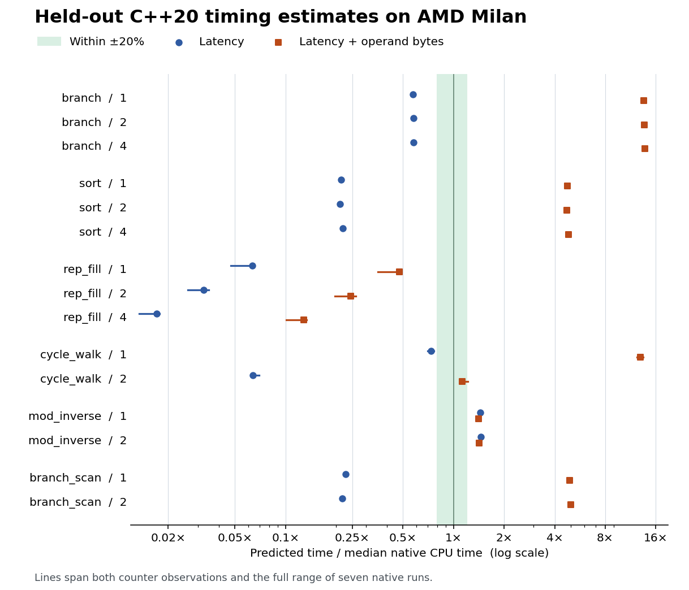

# C++20 grading-time estimates with Durante v11

Adding nominal operand bytes to the static latency counter put **1 of 15 held-out cases** within 20% of its native CPU time on a pinned AMD Milan VM. Latency alone covered 0 of 15. The median absolute error across held-out cases grew from **78.2% to 377.0%**. The one success also had native spread above the registered 10% threshold. These results leave the candidate outside the accuracy target for C++20 grading. [Measurements](measurements.json.gz) · [Model weights and per-case results](evaluation.json.gz)

## Prediction error and implied verdicts

The primary comparison fits nonnegative coefficients to six integer-recurrence and REP-copy cases. Each training case contributes equally to squared relative error. All inputs for the other six programs are held out. Both counter observations for a case must predict its seven-run native median within ±20%. The live-compatible row uses the production formula with coefficients fitted to these six cases. All four training matrices have full rank. Training STOS bytes stay at 3,624 across all six cases, and the separate STOS coefficient fits to zero. [Analysis plan](analysis-plan.json)

| Locally fitted C++20 model | Training within ±20% | Original holdouts | Additional holdouts | Median absolute held-out error | False TLE | False pass |
|---|---:|---:|---:|---:|---:|---:|
| Instructions + total REP bytes | 6/6 | 0/9 | 0/6 | 64.6% | 4 | 6 |
| Instructions + MOVS + STOS bytes (live-compatible) | 6/6 | 0/9 | 0/6 | 64.6% | 4 | 9 |
| Static latency | 3/6 | 0/9 | 0/6 | 78.2% | 2 | 13 |
| Static latency + nominal operand bytes | 3/6 | 0/9 | 1/6 | 377.0% | 11 | 3 |

For each held-out input the low limit is 80% of its native median rounded down to whole milliseconds and the high limit is 120% rounded up. The seven native samples agree on 27 of these 30 boundaries. The other three are the upper limits for REP fill. The last two columns count retrospective disagreements with unanimous native outcomes. All executions ran to completion. Using the minimum native time with the same weights gives 0/15 within ±20% for all four locally fitted models. Of the nine held-out inputs meeting both native quality tests, none is within ±20% for latency plus operand bytes.



In a separately registered transfer comparison, the previously frozen Rust coefficients cover 3/15 with instructions plus total REP, 1/15 with latency, and 0/15 with latency plus operand bytes. The Rust fit saw nearly constant REP volume, while these C++ programs explicitly execute repeated copies and fills. Each panel uses only its designated training data. [Frozen Rust evaluation](https://github.com/seo-rii/durante/blob/74d9188f9fd86c75f079277e6e5278b379a0a1d7/experiments/results/gce-rust-operand-bytes/evaluation.json)

## Why more bytes did not improve the clock

**Repeated copies.** Between training inputs `rep_copy/1` and `rep_copy/4`, requested MOVS bytes rise from 2 GiB to 8 GiB and native CPU time rises from 62.38 to 231.91 ms. Nominal operand bytes rise by 0.11% and modeled cycles by 0.07%. A REP site contributes its decoded operand widths once per entry regardless of the repeat count. Fitting the two features assigns 1.568 ns to each nominal byte. On the held-out `branch/4`, which has over 21 times the maximum training byte count, that model predicts 1,754.70 ms against a 127.86 ms native median.

**Dependent reads.** The two `cycle_walk` inputs use the same ELF, initialize the same 64 MiB table and perform 2,097,573 dependent loads. The active footprint changes from 32 KiB to 64 MiB. Native CPU time rises from **18.280 to 210.073 ms (11.49×)**, while both latency and nominal bytes change by less than 0.0002%. The combined model predicts 236.918 ms for each input at the displayed precision. This directly shows the information lost when counting only decoded memory widths. The experiment measured the effect of the footprint without collecting hardware cache-miss events. [Workload source](corpus/sources/cycle_walk.cpp)

**A lower bound independent of training.** Even the fastest large-footprint walk took 194.132 ms and the slowest small-footprint walk took 19.197 ms. The largest recorded latency or operand ratio between these inputs was 1.0000017. With nonnegative weights, a weighted sum cannot exceed that ratio either, so at least one of the two predictions must miss by **82.00% or more** when allowing the entire observed native range. Among pairs of different held-out programs, `rep_fill/4` versus `cycle_walk/1` gives an even larger lower bound of **95.04%** for the same two-feature model. The verifier enumerates the preregistered pairs and allows one nanosecond for final rounding. Additional work on a clock with REP and memory-locality features can use these cases as controls and reserve fresh programs for qualification. [Witness selection](witness-plan.json) · [Exact bounds](evaluation.json.gz)

## Collection and application checks

The [preregistration commit](https://github.com/seo-rii/aonohako/commit/d66e5aad033e94d3d80575083e0b4eae3accc11f) records the binaries, inputs, split, schedule and scoring rules before starting the guest. The study used one `n2d-standard-4` VM in Seoul, one thread per core, and CPU 1 for every benchmark process. Each input had one native warmup, seven timed native runs and two v11 diagnostic runs. Native time is `wait4` user plus system CPU for the program including startup. The same static ELF and stdin went through the v11 CLI with the x86-64-v2 CPUID profile. The native runs saw the guest CPU. Kernel exec tracing placed all 168 native launches (including warmups), 42 supervisors and 42 metered roots on CPU 1. Trace loss and guest steal ticks were zero. The disposable VM and disk returned HTTP 404 after deletion and the SSH key was removed. [Schedule](protocol.json) · [CPU placement](placement.json.gz) · [Cleanup](cleanup.json)

All 210 runs produced the oracle output. All 42 metered reports were complete, uninterrupted and diagnostic-only. The two repetitions agreed exactly on all six counters for 19 of 21 cases. On `integer/4` and `branch/4` they differed by 16 instructions, 4 modeled cycles and 48 nominal operand bytes. REP totals agreed across repetitions for all 21. Eight cases missed the 20 ms native floor or the 10% spread threshold. Every sample is included. The scope is one VM, eight programs and three additional held-out algorithm families. [Original CLI receipts](reports.tar.xz) · [Raw timings](measurements.json.gz)

A separate local run sent the scale-one input for each of the eight executables through Aonohako's embedded v11 HTTP service. All eight returned Accepted, the expected stdout and the requested counters. The worker's source, client, launcher and release-core digests match the GCE artifacts. REP bytes agree on every input. The embedded worker counted 21,941–22,788 additional instructions and 8,923–10,166 additional nominal bytes compared with the GCE CLI. The two launch environments differ. The model comparison uses the GCE measurements throughout. [HTTP observations](embedded-http.json)

## Replaying the result

Run these commands from the Aonohako repository root.

```sh
study=docs/durante/gce-v11-cpp20-accuracy
python3 "$study/verify.py"
python3 -m unittest discover -s "$study" -p 'test_models.py'
```

The verifier uses the Python standard library to check the frozen source and ELF hashes, input and output hashes, one-to-one trial and CPU placement records, original CLI reports, local HTTP observations, both model panels and the coefficient-independent bounds. The chart can be regenerated with `python3 docs/durante/gce-v11-cpp20-accuracy/plot.py` in an environment with Matplotlib. [Exact measured ELFs](corpus/elfs.tar.xz) · [Compiler flags and identity](corpus/build.json) · [Input/output manifest](corpus/cases.json)

To repeat the guest runs, use the tool and runtime digests in `protocol.json` and a Linux guest with the recorded CPU configuration. Recreate the protocol's relative directory layout, including the five existing C++ sources from `internal/durante/reference/fixtures`, the three sources under `corpus/sources`, and the eight ELFs in `corpus/bin`. Generate `checksums.sha256` from the protocol's `artifacts` map plus the protocol file's own SHA-256. The guest entry point uses a systemd CPU-1 cpuset and tracefs. Invoke it on CPU 0 before creating the guest output directory. [Guest entry point](guest.sh) · [Collection code](bench.py)
